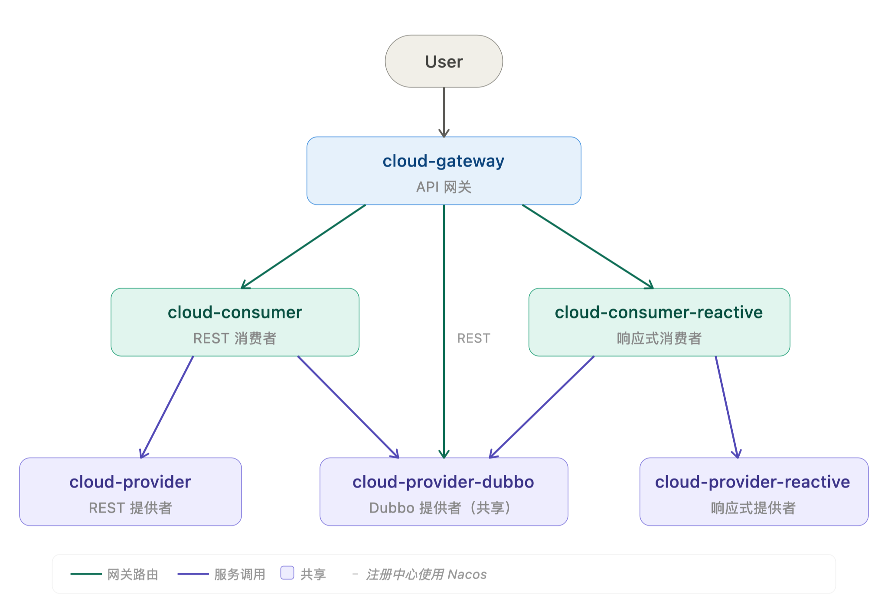

# ☁️ spacecloud
> 基于 **Spring Boot 4.1** + **Spring Cloud Alibaba 2025.1.x** 的生产级微服务模板项目 <br>
> 涵盖 16 个模块，覆盖 HTTP/Dubbo/gRPC 多协议、Seata 分布式事务、Stream 消息驱动、Kafka 4.x 及 Spring AI 2.0，支持 AI 一键演示


### 📦 模块介绍
| 模块                              | 简称              | 端口  | 说明                  |
|-----------------------------------|-------------------|-------|-----------------------|
| 🔍 cloud-nacos-discovery-sample   | discovery         | 8760  | Nacos Discovery       |
| ⚙️ cloud-nacos-config-sample      | config            | 8761  | Nacos Config          |
| ⚡ cloud-provider-reactive-sample | provider-reactive | 8762  | Reactive Web Provider |
| ⚡ cloud-consumer-reactive-sample | consumer-reactive | 8763  | Reactive Web Consumer |
| 🌐 cloud-gateway-sample           | gateway           | 8764  | Spring Cloud Gateway  |
| 📤 cloud-provider-sample          | provider          | 8765  | Web Provider          |
| 📥 cloud-consumer-sample          | consumer          | 8766  | Web Consumer          |
| 🚀 cloud-provider-dubbo-sample    | provider-dubbo    | 50051 | Dubbo Provider        |
| 🔌 cloud-grpc-server-sample       | grpc-server       | 9090  | gRPC Server           |
| 📋 cloud-sample-api               | api               | -     | Interface & Proto     |
| 🧩 cloud-commons                  | commons           | -     | Cloud Commons         |
| 📨 cloud-stream-sample            | stream            | 8767  | Spring Cloud Stream   |
| 🔄 cloud-seata-sample             | seata             | ...   | Seata (含 7 个子模块) |
| 🤖 cloud-ai-sample                | ai                | 8888  | Spring AI             |
| 🤖 cloud-ai-rag-sample            | rag               | 8889  | Spring AI · RAG       |
| 📨 cloud-kafka-sample             | kafka             | 8768  | Kafka 4.x             |



### 🎮 演示方式

| 方式                    | 说明                                                        | 适用场景             |
|-------------------------|-------------------------------------------------------------|----------------------|
| 🤖 **AI Skill（推荐）** | 告诉 AI 助手 "演示项目"，自动完成环境检查、启动、验证全流程 | 快速体验、集成测试   |
| 📜 **一键脚本**         | 通过 `start-all.sh` 脚本自动化启动和验证                    | 批量验证、CI/CD      |
| 🐳 **Docker 部署**      | 中间件本地运行，微服务全部容器化                            | 容器化实践、贴近生产 |
| 🔧 **手动启动**         | 逐个模块手动启动，灵活控制                                  | 学习调试、单模块开发 |

#### 🤖 AI 一键演示（推荐）

本项目内置 Agent Skill，支持任意 AI 编程助手一键演示。

**Qoder / IDEA Qoder 插件**：克隆项目后打开，告诉 AI "演示本项目"

**QoderWork / 其他 AI**：告诉 AI 下面这句话即可
```text
克隆项目 https://github.com/javahongxi/spacecloud 并按其内置的 SKILL 演示该项目
```

均可自动完成环境检查、服务启动、接口验证全流程，无需手动操作。

```
# 快速体验（仅需 Nacos）
告诉 AI: "演示本项目"

# 单独验证某个场景
告诉 AI: "验证 Seata 分布式事务"
告诉 AI: "验证 Stream 消息收发"
告诉 AI: "演示 Spring AI"
告诉 AI: "演示一下视觉理解"
```

详见 [SKILL.md](.qoder/skills/space-cloud-run/SKILL.md)

#### 📜 一键脚本

```shell
sh start-all.sh install  # 检查并安装中间件 + 打包模块
sh start-all.sh          # 启动所有服务（自动检查、打包、启动、验证）
sh start-all.sh build    # 打包所有模块
sh start-all.sh stop     # 停止所有服务
```

> 更多命令（seata / verify / status / logs 等）请参考 `sh start-all.sh -h`
>
> 脚本流程：检查 Nacos → 检查 RocketMQ/MySQL/Seata Server（自动启动）→ 安装依赖模块 → 打包 → 按顺序启动所有模块 → 执行验证 → 汇总结果

#### 🐳 Docker 部署

中间件本地运行，微服务全部 Docker 容器化，通过 `host.docker.internal` 连接宿主机中间件。

**架构**

```
Mac 宿主机
├── 本地中间件: Nacos(8848) / RocketMQ(9876) / MySQL(3306) / PostgreSQL(5432, 仅 RAG 模块)
│
└── Docker 容器 (通过 host.docker.internal 连宿主机)
    ├── 核心微服务 (9个): gateway / consumer / provider / grpc-server ...
    ├── Stream 消息         (profile: stream)
    ├── Spring AI           (profile: ai)
    └── Seata 分布式事务   (profile: seata)
```

**快速开始**

```shell
# 1. 启动本地中间件（Nacos / RocketMQ / MySQL，RAG 模块还需 PostgreSQL）
./start-all.sh infra

# 2. Maven 打包 + 构建所有 Docker 镜像
./docker-build.sh build

# 3. 启动核心微服务 (9个)
./docker-build.sh up

# 4. 验证
curl 'http://localhost:8766/hi?name=docker'
curl 'http://localhost:8764/consumer-sample/hi?name=docker'
```

> 更多命令（build-one / up-stream / up-ai / up-seata / status / logs / clean 等）请参考 `./docker-build.sh --h`
>
> Docker 推荐 [OrbStack](https://orbstack.dev)（`brew install orbstack`），国内拉镜像需配置[镜像加速](https://docs.orbstack.dev/docker/registry-mirrors)。

#### 🔧 手动启动

按下面的功能场景逐步操作，详细演示步骤参考对应文档：

| 场景                        | 说明                                                                  | 参考文档                                                                            |
|-----------------------------|-----------------------------------------------------------------------|-------------------------------------------------------------------------------------|
| 🔍 服务注册与发现           | Nacos Discovery、Web / Reactive / Dubbo / gRPC 多协议                 | [discovery.md](.qoder/skills/space-cloud-run/references/discovery.md)               |
| 🔍 Trace 链路追踪           | 五条跨服务链路，验证 trace context 传播                               | [trace.md](.qoder/skills/space-cloud-run/references/trace.md)                       |
| ⚙️ Nacos Config 动态配置    | `@NacosConfig` / `@ConfigurationProperties` / `@RefreshScope`         | [nacos-config.md](.qoder/skills/space-cloud-run/references/nacos-config.md)         |
| 🛡️ Sentinel 限流（Gateway） | Gateway 级限流，规则 Nacos 动态推送                                   | [sentinel-gateway.md](.qoder/skills/space-cloud-run/references/sentinel-gateway.md) |
| 🛡️ Sentinel 熔断（App）     | 应用级熔断降级（Feign / RestTemplate）                                | [sentinel-app.md](.qoder/skills/space-cloud-run/references/sentinel-app.md)         |
| 📨 Stream 消息驱动          | 基础消费、定时消息源、消息管道、延迟/顺序/事务消息                    | [stream.md](.qoder/skills/space-cloud-run/references/stream.md)                     |
| 🔄 Seata 分布式事务         | RestTemplate / Feign / Dubbo 三种调用链路                             | [seata.md](.qoder/skills/space-cloud-run/references/seata.md)                       |
| 🤖 Spring AI                | 对话、Tool Calling、ReAct Agent、视觉理解、ChatMemory、PromptTemplate | [spring-ai.md](.qoder/skills/space-cloud-run/references/spring-ai.md)               |
| 🤖 Spring AI RAG            | PgVector 向量存储，检索增强生成                                       | [spring-ai-rag.md](.qoder/skills/space-cloud-run/references/spring-ai-rag.md)       |
| 📨 Kafka 4.x                | 传统 Consumer Group、Share Groups、事务消息                           | [kafka.md](.qoder/skills/space-cloud-run/references/kafka.md)                       |

&copy; [hongxi.org](http://hongxi.org)
